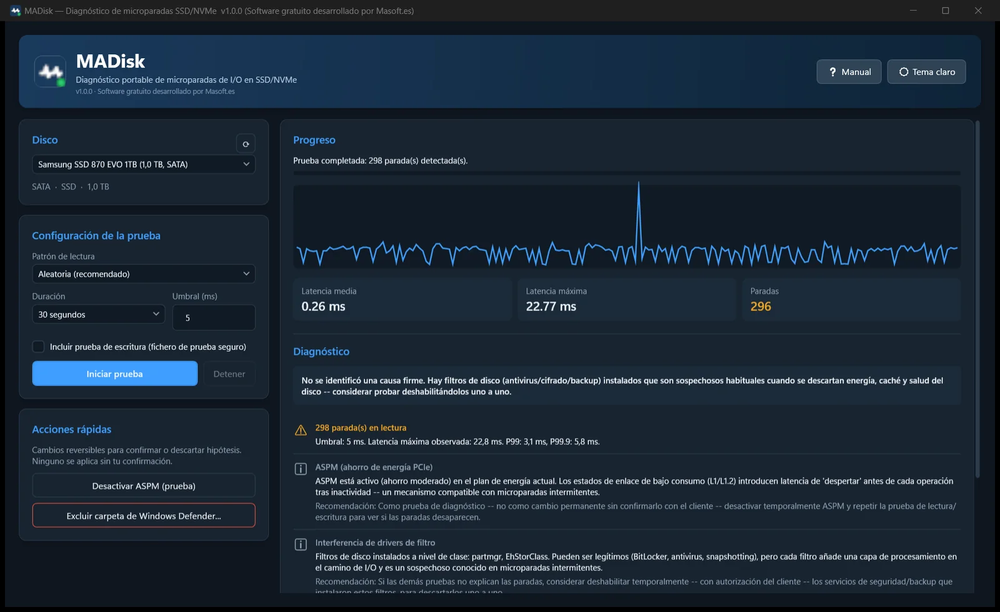
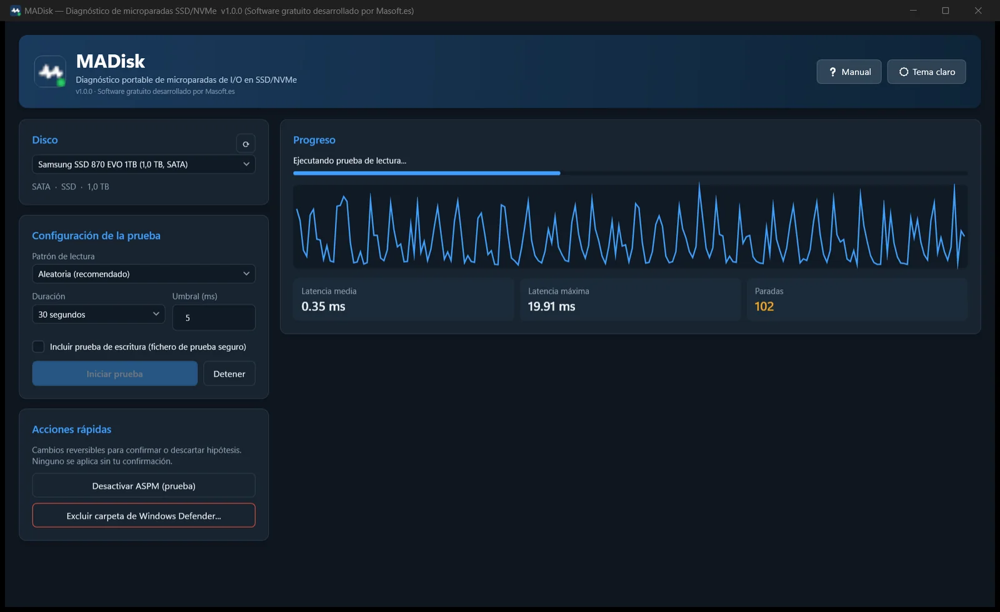
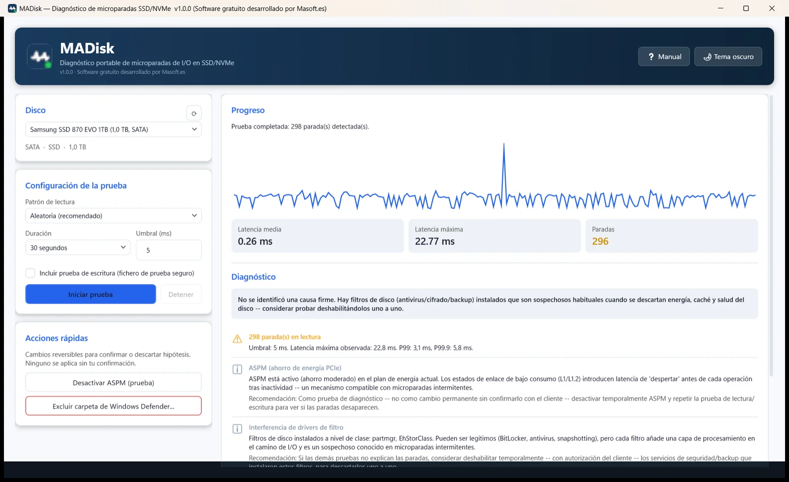

# MADisk

Diagnóstico de las microparadas de un disco SSD o NVMe: el equipo se queda congelado un instante y el disco no marca ningún error. MADisk mide la latencia de cada lectura del disco físico, cruza las paradas con la salud que informa el propio disco y propone la causa más probable, con informe PDF.

**Software gratuito desarrollado por [Masoft.es](https://masoft.es)**

[](https://github.com/MaSoft/MADisk/releases/latest)

Más información y el manual también en [masoft.es](https://masoft.es/descargas.html#madisk).



## Características
- Latencia de cada lectura directa del disco físico, sin la caché de Windows, y gráfico en vivo.
- Prueba de lectura de solo lectura: nunca escribe en el disco.
- Prueba de escritura opcional sobre un fichero temporal que se borra solo.
- Salud NVMe: temperatura, desgaste, reserva disponible, horas de encendido y avisos críticos.
- Diagnóstico con la causa más probable: ahorro de energía, espera tras inactividad, caché SLC o filtros de disco.
- Acciones reversibles para confirmar la causa: desactivar ASPM y excluir una carpeta de Windows Defender.
- Informe PDF para el cliente o el parte de trabajo, tema oscuro y claro y manual con F1.

## Capturas

| | |
|---|---|
| <br>**Prueba en curso.** Latencia de cada lectura en vivo, media, máxima y número de paradas. | <br>**Tema claro.** La misma ventana en tema claro, con un clic. |

## Requisitos

| | |
|---|---|
| Sistema | Windows 10 o Windows 11 de 64 bits |
| Permisos | Administrador local: Windows lo pide al abrir MADisk |
| Instalación | Instalador (pide permisos de administrador) o ejecutable único que se copia y se abre; no necesita .NET. |
| Espacio | 63 MB el programa, y 512 MB libres si se hace la prueba de escritura |
| Discos | NVMe, SATA, SAS y USB. La salud NVMe solo aparece en discos NVMe que la ofrecen |

MADisk no guarda datos propios: solo el informe PDF, donde tú elijas.

## Descarga y comprobación

En [Releases](https://github.com/MaSoft/MADisk/releases/latest) están el instalador (`MADisk_Setup_v1.0.0.exe`), el ejecutable único (`MADisk_v1.0.0.exe`), sus huellas SHA-256 y el manual. Para comprobar que la descarga está completa, en PowerShell:

```powershell
Get-FileHash .\MADisk_Setup_v1.0.0.exe
Get-FileHash .\MADisk_v1.0.0.exe
```

Deben coincidir con `72586afa5c6fed82bdd29135dc028db905749a0f3d1470e4259acb3c41381347` (instalador) y `34ce286c1ee7e93a722f00afb1c6a678ebfb50c40d673bf099a8e7d6326608c8` (ejecutable único).

## Manual

[manual_MADisk.html](https://github.com/MaSoft/MADisk/releases/latest/download/manual_MADisk.html): descárgalo y ábrelo en el navegador.

## Aviso legal

MADisk es gratuito y se entrega tal cual, sin garantía de ningún tipo. Al descargarlo y usarlo aceptas el aviso legal y las limitaciones de su manual.

> ⚠ Herramienta de diagnóstico para personal técnico. MADisk lee el disco físico a bajo nivel y puede cambiar ajustes de energía y de Windows Defender. Úsalo solo en equipos sobre los que tengas autorización, y deshaz las acciones rápidas al terminar.

**Limitaciones y exclusión de responsabilidad**
- MADisk se proporciona tal cual, sin garantía de ningún tipo.
- El diagnóstico se basa en mediciones de latencia, en los datos que el propio disco informa y en indicios estadísticos. Es un apoyo al técnico, no una certeza ni una garantía sobre el estado futuro del disco.
- La prueba de lectura no escribe en el disco, pero cualquier disco que ya esté fallando puede empeorar con un uso intensivo: haz copia de seguridad antes si sospechas de su estado.
- Desactivar ASPM aumenta el consumo y excluir una carpeta de Defender reduce la protección. El autor no se hace responsable de dejar esos cambios aplicados.
- El autor no se hace responsable de pérdidas de datos, interrupciones de servicio o daños derivados de un uso inadecuado.

Este repositorio solo contiene el programa compilado y su documentación. © Masoft.es. Todos los derechos reservados.
